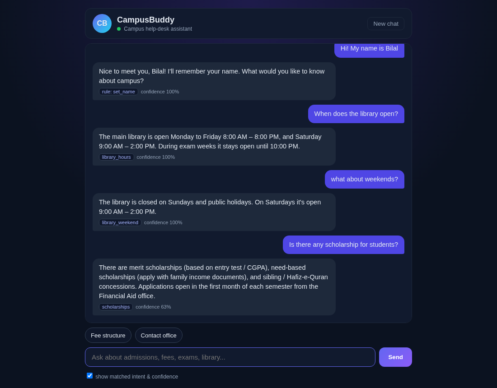
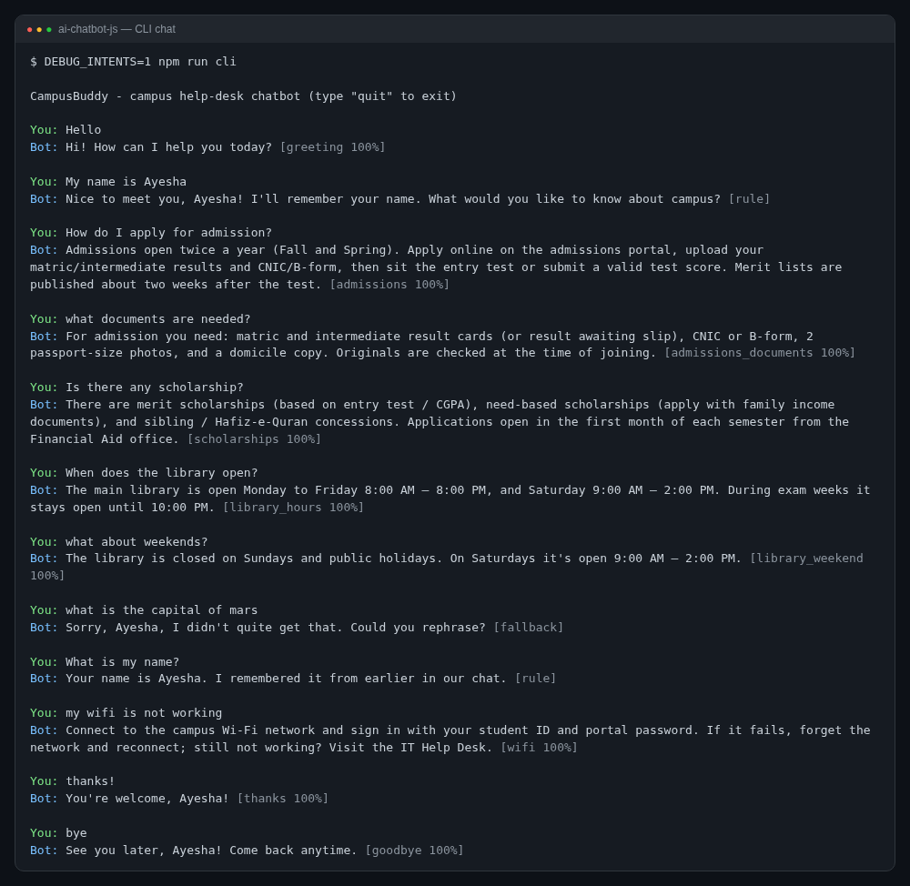
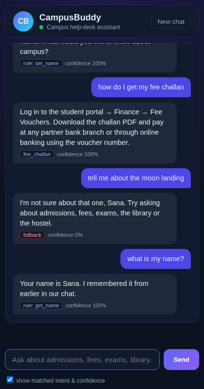
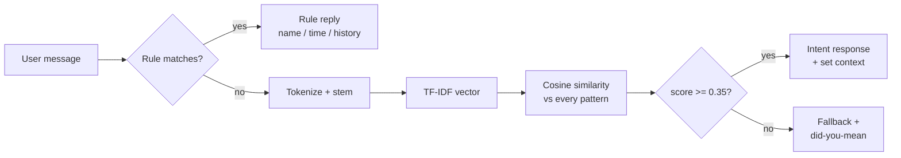

# CampusBuddy — AI Chatbot (Node.js)

A campus help-desk chatbot that answers students' common questions (admissions, fees, scholarships, exams, library, hostel, transport, Wi-Fi, LMS…). It combines a **rule-based layer** with **TF-IDF + cosine-similarity intent matching**, remembers your name and the conversation context, and comes with both a **command-line chat** and a **web chat UI** served by Express. No paid APIs — everything runs locally.




## Features

- **31 intents / 203 example patterns** in `data/intents.json` — easy to extend without touching code
- **Intent matching**: TF-IDF vectors over all patterns, cosine similarity, best pattern wins; a confidence threshold decides when to fall back
- **Rule-based layer** (regex) that runs first: captures your name ("my name is…", "call me…"), answers "what's my name?", "what time is it?", "what did I just ask?", and "forget me"
- **Memory per session**: name, current context, last intent and the last 20 messages
- **Context-aware follow-ups**: after asking about the library, "what about weekends?" is understood as a library question (intents with `context_set` / `context_filter`)
- **Fallback handling**: polite rephrase message, "did you mean…" hints from the closest intents, and after 3 misses it points the student to a human office
- Unknown-word penalty: messages made mostly of words the bot has never seen ("capital of mars") can't produce a confident match from one shared word
- **CLI** (`npm run cli`) and **web UI** (vanilla HTML/CSS/JS) with quick-reply chips and an optional intent/confidence badge
- **REST API**: `POST /api/chat`, `GET /api/intents`, `DELETE /api/session/:id`, `GET /api/health`
- **26 Jest + Supertest tests**

## Tech Stack

| Part | Technology |
|---|---|
| Runtime | Node.js 18+ |
| Server | Express 4 |
| NLP | Own tokenizer, suffix stemmer, TF-IDF and cosine similarity |
| Front end | HTML, CSS, vanilla JavaScript (fetch API) |
| Testing | Jest, Supertest |

## Project Structure

```
ai-chatbot-js/
├── data/
│   └── intents.json        # intents: tag, patterns, responses, suggestions, context
├── src/
│   ├── nlp.js              # tokenizer, stemmer, TF-IDF model, cosine similarity
│   ├── intentMatcher.js    # finds the best intent for a message
│   ├── rules.js            # regex rules (name memory, time, history, forget)
│   ├── memory.js           # per-session memory store
│   ├── chatbot.js          # rules -> intents -> fallback pipeline
│   ├── cli.js              # terminal chat
│   ├── app.js              # Express app (REST API + static UI)
│   └── server.js           # starts the server
├── public/                 # web chat UI (index.html, style.css, app.js)
├── tests/                  # Jest + Supertest
└── screenshots/
```

## How to Run

1. Install [Node.js 18+](https://nodejs.org/).
2. Clone and install:
   ```bash
   git clone https://github.com/Mo-aini/ai-chatbot-js.git
   cd ai-chatbot-js
   npm install
   ```
3. Chat in the terminal (`DEBUG_INTENTS=1` also prints the matched intent and confidence):
   ```bash
   npm run cli
   ```
4. Or start the web app and open http://localhost:3000:
   ```bash
   npm start
   ```
5. Use the API directly:
   ```bash
   curl -X POST http://localhost:3000/api/chat \
        -H "Content-Type: application/json" \
        -d '{"message": "When does the library open?"}'
   ```
   ```json
   {"sessionId":"…","reply":"The main library is open Monday to Friday 8:00 AM – 8:00 PM, …","intent":"library_hours","confidence":1,"source":"intent","suggestions":["Borrow books","Library on weekends"],"name":null}
   ```
   Send the returned `sessionId` with the next message to keep the memory.
6. Run the tests:
   ```bash
   npm test
   ```

## Sample Output / Screenshots

Terminal chat — name memory, a context follow-up ("what documents are needed?" / "what about weekends?") and a fallback:



Web UI on a phone-sized screen:



## How It Works



1. **Rules first** — regexes are better than similarity for extracting a name or answering "what's my name".
2. **TF-IDF** — every example pattern becomes a vector; rare, specific words ("challan", "hostel") weigh more than common ones.
3. **Cosine similarity** between the message and each pattern; the best score per intent is that intent's confidence.
4. **Threshold** — below 0.35 the bot admits it doesn't know instead of guessing.
5. **Context** — some intents set a context (e.g. `library`); follow-up intents with a matching `context_filter` only compete while that context is active.

### Adding a new intent

```json
{
  "tag": "parking",
  "patterns": ["where can i park", "parking for students", "is there a car parking"],
  "responses": ["Student parking is behind the engineering block; show your student card at the gate."]
}
```

Restart the app — no code change needed.

## What I Learned

- How TF-IDF and cosine similarity turn "which question is this?" into simple vector maths.
- Why a **confidence threshold** and a good fallback matter more for user trust than a few extra correct answers.
- Rules and ML work best **together**: regex for structure (names), similarity for free-form questions.
- Separating `createApp()` from `listen()` makes an Express API easy to test with Supertest.

> The answers in `intents.json` are sample help-desk content for a generic university campus, written for this project — replace them with your own institution's details.

## Author

**Mohammed Emad ALaini** — BS Software Engineering, Superior University

## License

[MIT](LICENSE)
